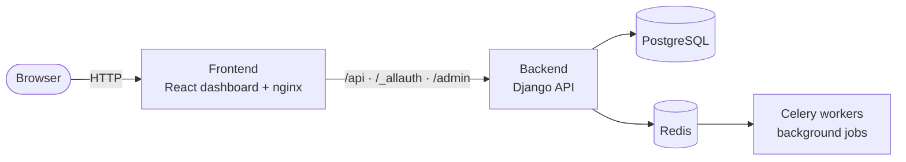

<div align="center">


# NekkoGuard

### Self-hosted guardian for your home network

Know what's on your network, see what changed, and get warned before something goes wrong —
running privately on a Raspberry Pi.

[](https://github.com/NekkoRaspberry/NekkoGuard/actions/workflows/ci.yml)
[](nekkoguard_BE/ROADMAP.md)
[](https://github.com/orgs/NekkoRaspberry/projects/1)
[](https://github.com/NekkoRaspberry/NekkoGuard/issues)


[Overview](#-overview) •
[Features](#-features) •
[Architecture](#-architecture) •
[Getting started](#-getting-started) •
[Development](#-development) •
[Security](#-security) •
[Roadmap](#-roadmap)

</div>

---

## 📖 Overview

A modern home has more connected devices than anyone can keep track of — laptops, phones, TVs, cameras, printers, small servers. Each one is a door into the network, and most people don't know which doors are open.

**NekkoGuard keeps watch.** It runs on a Raspberry Pi inside your network, maps the devices on it, notices when something new appears or changes, and warns you about real problems: an exposed service, a certificate about to expire, a device that shouldn't be there.

Companies have security teams for this. Homes and small offices have nothing. NekkoGuard brings the same visibility to a small, affordable box — with a dashboard anyone can read.

> [!NOTE]
> NekkoGuard is in **early development** (milestone **v0.1 Auth**). The account and security foundation is in place; network monitoring features arrive in the next releases.

### Principles

| 🏠 Private | 🍃 Lightweight | 🔒 Secure | 🙂 Simple |
|:---:|:---:|:---:|:---:|
| Self-hosted, no cloud, no data leaves your home | Built to run 24/7 on a Raspberry Pi | Two-factor where it matters, nothing exposed by default | A clear dashboard first, details on demand |

---

## ✨ Features

| | Feature | Status |
|:---:|---|:---:|
| 🔐 | **Accounts** — sign-up, email verification, two-factor authentication, recovery codes | ✅ Available |
| 🌍 | **External sign-in** — Google, GitHub, LinkedIn | ✅ Available |
| 🔗 | **Connected apps** — "Sign in with NekkoGuard" for your other self-hosted tools | ✅ Available |
| 👮 | **Protected admin** — administration only after two-factor sign-in | ✅ Available |
| 👥 | **Organizations** — homes, clients and sites, with roles | 🚧 Next |
| 📡 | **Network discovery** — every device and its history | 📅 Planned |
| 🔌 | **Ports & services** — what each device exposes | 📅 Planned |
| 🚨 | **Alerts & overview** — new devices and open ports in one dashboard | 📅 Planned |
| 📜 | **Certificates & email security** — expiry and misconfiguration checks | 📅 Planned |
| 🐳 | **Pi-hole & containers** — DNS statistics and Docker at a glance | 📅 Planned |

---

## 🧩 Architecture

The browser only talks to the **frontend**, which serves the dashboard and forwards API calls to the **backend**. Nothing else needs to be reachable from your network.



### Repository structure

| Path | What it is |
|---|---|
| [`nekkoguard_BE/`](nekkoguard_BE/) | **Backend** — Django API, accounts and security, background jobs |
| [`nekkoguard_FE/`](nekkoguard_FE/) | **Frontend** — React dashboard, served by nginx |
| [`.github/`](.github/) | CI pipeline and Dependabot updates |
| [`.pre-commit-config.yaml`](.pre-commit-config.yaml) | Code-quality hooks (backend) |

Each part has its own README with full details: [Backend](nekkoguard_BE/README.md) · [Frontend](nekkoguard_FE/README.md)

---

## 🚀 Getting started

### Prerequisites

- A Raspberry Pi 4 (or any ARM64 / x86-64 Linux host)
- Docker Engine with the Compose plugin
- Git

### 1 · Configure

Settings and secrets live in environment files that are **never committed**:

```text
nekkoguard_BE/.envs/.local/.django      Django settings, secrets, optional sign-in providers
nekkoguard_BE/.envs/.local/.postgres    Database connection
nekkoguard_FE/.env                      Optional: ports and backend address (see .env.example)
```

### 2 · Run

```bash
# Backend (API, workers)
cd nekkoguard_BE
docker compose -f docker-compose.local.yml up -d

# Frontend (dashboard)
cd ../nekkoguard_FE
docker compose up -d --build
```

### 3 · Open

| Service | Address |
|---|---|
| Dashboard | `http://<PI_IP>:8080` |
| Backend API | `http://<PI_IP>:8000` |
| Celery monitor (Flower) | `http://<PI_IP>:5555` |

Create your account in the dashboard, then enable two-factor authentication under **Account → Security**.

### Environments

| Compose file | Use | Includes |
|---|---|---|
| `docker-compose.local.yml` | Day-to-day on the Pi | Django, Redis, Celery, Flower *(uses the shared PostgreSQL and Mailpit)* |
| `docker-compose.development.yml` | Self-contained / CI | + its own PostgreSQL and Mailpit |
| `docker-compose.production.yml` | Production | + Traefik (HTTPS) and nginx |

---

## 💻 Development

### Branching

```text
feature work  →  dev  →  pull request  →  main
```

- `dev` is the integration branch; `main` only changes through reviewed pull requests.
- After merging into `main`, merge `main` back into `dev` to keep them in sync.

### Quality checks

| Check | Command |
|---|---|
| Backend tests | `cd nekkoguard_BE && docker compose -f docker-compose.local.yml run --rm django pytest` |
| Backend lint & format | `pre-commit run --all-files` *(from the repository root)* |
| Frontend type-check & lint | `cd nekkoguard_FE && docker compose --profile dev run --rm frontend-dev npm run lint` |

### CI/CD

Every pull request to `main` runs the [CI pipeline](.github/workflows/ci.yml):

| Job | What it does |
|---|---|
| `linter` | pre-commit hooks — formatting, ruff, Django upgrades, template linting |
| `pytest` | Builds the backend image, checks migrations, runs the test suite |

Dependabot keeps Python, npm, Docker and GitHub Actions dependencies up to date.

---

## 🔒 Security

- **Secrets never go into git.** Environment files, keys and certificates stay in git-ignored folders.
- **Two-factor authentication** is available to every user and required for the admin.
- **Same-origin by design** — the dashboard and API share one address, with strict security headers.

Found a vulnerability? Please **don't open a public issue** — contact the maintainer privately.

---

## 📍 Roadmap

| Release | Focus |
|---|---|
| 🚧 **v0.1** | Accounts, two-factor, external sign-in, connected apps — *finishing* |
| 📅 **v0.2** | Organizations, clients, sites and roles — *next* |
| 📅 **v0.3 – v0.5** | Network discovery, devices, ports & services, alerts and overview |
| 📅 **v0.6 – v0.12** | Certificates, email security, Pi-hole, containers, agents, logs, analytics |
| 🎯 **v1.0** | Production release |

Details per release: [ROADMAP.md](nekkoguard_BE/ROADMAP.md) · Progress: [project board](https://github.com/orgs/NekkoRaspberry/projects/1)

---

## 🤝 Contributing

1. Pick or open an issue on the [project board](https://github.com/orgs/NekkoRaspberry/projects/1) (labels `backend` / `frontend`).
2. Branch from `dev`, keep changes small, and run the quality checks.
3. Open a pull request into `dev`.

---

<div align="center">
<sub>Made for the Raspberry Pi · Lightweight · Private · Always on</sub>
</div>
